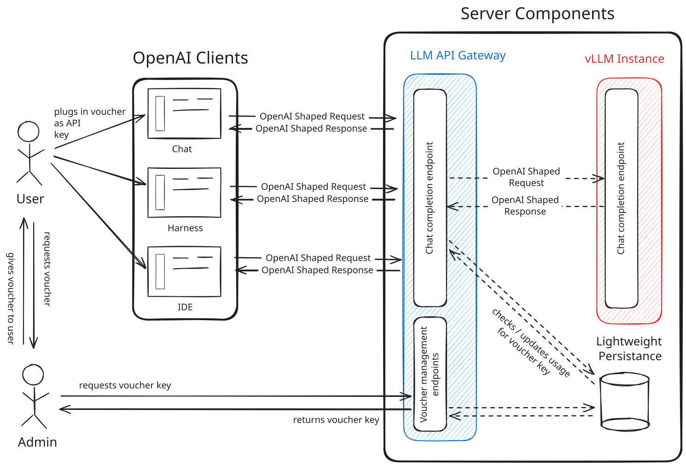

# LLM Voucher Gateway

This application provides a gateway to self-hosted LLMs, allowing a hosted LLM model to serve multiple users with usage constraints in place. It provides the following benefits over direct access to the LLM API:

1. _Access control_. Only users who have been issued a voucher can use the API.
1. _Budget enforcement_. Usage is tracked per-voucher, and usage is capped at voucher issuance.
1. _Expiry_. Vouchers expiry date is set at issuance.

As an example, an admin may issue a voucher to a user allowing them to use a total of 10000 tokens, and set the expiry date to one month from the date of issuance. After all tokens are consumed, or after the expiry date, the user will no longer be able to use the API.

This application is free for public use. All that is needed is infrastructure to host the components. Even a personal computer can work, given the right hardware.

## Goals and Motivation

The application provides a way to give users shared access to a hosted vLLM instance. It provides OpenAI shaped responses to hook into any application that supports the OpenAI API.

The primary motivation can be stated as follows:

> "I want to offer access to a hosted LLM model to my users while still retaining control over authorization (who can use it) and usage (how many tokens they can use)."

## Workflow

### Auth model

The client uses the voucher as the bearer token to authenticate with the Gateway API. vLLM is reachable only from the Gateway API, never publicly.

### Budget and Usage Recording Model

"Usage" is tracked on total tokens (input + output). This is reported by vLLM. Usage is updated upon each request.

Budgeting enforcement is checked before calls are forwarded to vLLM. If no budget remains, the call is denied.

### Voucher Issuance and Use

1. Admin requests vouchers for users using the Gateway's admin API.
1. Admin gives voucher to user.
1. User plugs in voucher to OpenAI compatible software and initiates a request.
1. LLM Gateway API checks remaining balance, only proceeding if user's token limit is not exceeded.
1. LLM Gateway API passes request through to vLLM.
1. vLLM Returns response, which is passed through unchanged to the client. Usage for the voucher is updated.

Users never hit vLLM directly. All requests flow through the Gateway API. This solution focuses on minimal complexity by minting vouchers that have no PII associated with them.

### Limitations

There is nothing stopping users from using all of their tokens in a short time period, which may strain the system. If you need this level of complexity, you'll have to extend the application.

